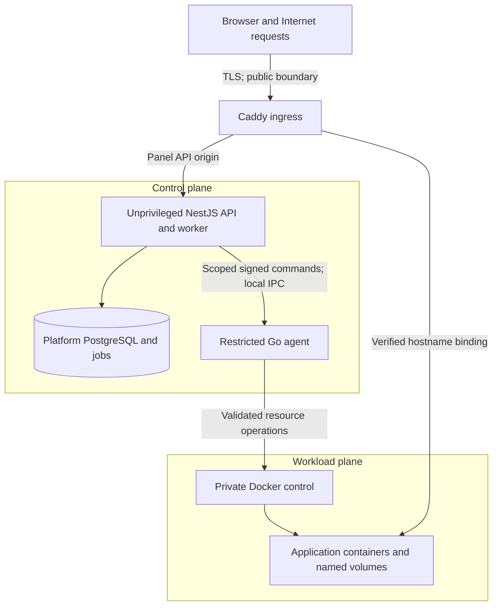

# Cloudlane security threat model

Date: 2026-11-19 (Africa/Nairobi). Task: CL-005. Status: **proposed; separate security review pending**.

Baseline: the source tree imported into GitHub at `cc2bd6da1f9ae27d0de21d9ab2a579e21d71a03e`, identical to Site checkpoint `1d913666a45dedf8598be71f69d4c54e0605bb19` (tree `ef1b3c8e13916dd56eb56cf8663339f605ba1c95`). This document evaluates that code and the target architecture in docs/02, 04, 05, 07, 08 and 10. It does not certify a running installation. See [ADR-017](../adr/017-security-boundaries.md) and the [negative-test and review matrix](SECURITY_ACCEPTANCE.md).

## Scope and assumptions

The first release is a dedicated Ubuntu VPS with one platform owner deploying code they trust. Internet visitors, uploaded files, application dependencies and compromised workloads remain untrusted. A trusted owner can make mistakes or deploy compromised code. Docker hardening reduces exposure but does not establish a boundary suitable for public tenants running arbitrary hostile builds on the control-plane VPS. Public multi-tenant hosting requires a separate isolation design and review, with independently isolated build/runtime hosts or stronger sandboxing evaluated before launch.

In scope: signed installer distribution, host changes and repair; first-owner claim and recovery; browser/API authentication and resource authorization; PostgreSQL/jobs; the privileged Go agent; archives/builds/runtime networks and volumes; Caddy routing and certificates; secret handling, supply chain, audit and restoration. DNS, cron, storage, GitHub and AI features are included where they cross these boundaries; their complete feature reviews belong to the implementing tasks.

An attacker with host root or provider-console control can alter binaries, keys, sockets, time and audit records. Cloudlane does not protect the owner from that administrator. Response requires external credential revocation and recovery onto a clean host. A compromised API is also a powerful attacker: it may use its signing identity and every capability delegated to it. Agent checks must contain its authority; signatures alone cannot distinguish a compromised signer from legitimate requests.

## What exists in the baseline

| Component | Source observation | Security limit |
| --- | --- | --- |
| Static dashboard and HTTP adapter | Separate demo/HTTP builds; runtime response validation; browser imports restricted | UI state and schema-valid JSON do not authorize an operation; production headers and authenticated browser flows are pending |
| NestJS foundation | Loopback bind, bounded JSON, strict request schemas, safe errors and public-safe installation status | Auth/resource operations return 501; no session, ownership guard, rate limiter or database exists |
| Agent contract | Four typed operations, UUID scopes, bounded fields, named volumes and an opaque authorization envelope | Structure and relative timestamp order only; no signature, present-time, replay, ownership or execution checks |
| Installer, agent, Docker and production Caddy | Requirement documents; a localhost-only development Caddyfile | No operational installer, IPC, isolation, public TLS or recovery evidence |
| CI and test harness | Negative schema/HTTP/boundary tests; synthetic desktop/mobile fixtures; pinned workflow | CI success is not authentication, penetration, live VPS or security-review acceptance |

## Assets and adversaries

| Asset | Required property | Principal adversaries |
| --- | --- | --- |
| Installation identity, first-owner state, recovery material | One owner; installation binding; controlled recovery | Unclaimed Internet visitor, stolen claim, concurrent claimant, stale backup |
| Password/session/MFA/API credentials and provider secrets | Confidentiality, scoped authority, rotation and revocation | XSS/CSRF sender, stolen session, compromised API/workload/dependency |
| Platform records, queue and authorization policy | Integrity, tenant/resource scope, durable ordering | Forged request, SQL injection, retried/stale job, compromised worker |
| Agent keys, Docker control, Caddy admin, host files | Narrow privileged authority and protected local access | Compromised API, malicious payload, escaped workload or build |
| Application artifacts, volumes, routes and customer data | Owner-scoped access, immutable promotion, reliable restoration | Malicious archive, cross-resource binding, domain takeover, unsafe repair |
| CPU/RAM/disk/inodes, certificates and audit history | Bounded consumption, availability and accountable changes | Floods, fork/log/archive bombs, failed renewal, destructive upgrade |

## Data flows and trust boundaries

The diagram describes the target VPS, not the private hosted design preview. Installer distribution and external integrations cross the additional boundaries listed below.

| Boundary | Untrusted input | Required enforcement point |
| --- | --- | --- |
| B1: publisher to root installer | Download, manifest, version, dependencies, update metadata | Authenticate the publisher using an independently trusted key; verify pinned artifacts before root execution; handle key rotation, rollback and revoked releases |
| B2: Internet to panel/API | Host/Origin, body, cookies, URLs, forwarded headers | Exact panel origin/routing; trusted TLS; bounded parsing; server-side sessions, CSRF, rate limits and authorization; trust proxy headers only from configured Caddy |
| B3: API/worker to DB and queue | Actor/resource IDs, query parameters, job payloads, retries | Parameterized SQL; least-privilege database accounts; transactional state/outbox; persisted actor/resource policy; recheck permission and generation when executing |
| B4: API to privileged agent | Command bytes, signature, timestamps, scope, IDs, limits | Permissioned Unix socket and peer identity; independent verifier/policy registry, replay journal and resource ceiling; no client-supplied host paths or raw Docker/Caddy configuration |
| B5: artifacts/builds/apps to host/control plane | ZIP members, Docker build steps, environment, network, mounts, logs | Safe extraction; isolated builds; restricted container profile; explicit network/egress policy and quotas; no control sockets, credentials or platform-network membership |
| B6: agent to Docker/Caddy/volumes | Candidate IDs, route bindings, desired generation, named volume IDs | Agent-owned mapping from IDs to authorized runtime resources; immutable digest and CAS promotion; protected admin sockets and validated generated config |
| B7: external services and recovery to platform | Webhooks, DNS, callbacks, S3 responses, backup archives, AI tool output | Verify source and resource scope; SSRF/redirect policy; private object grants; authenticated restore; AI actions use the initiating actor's current permission |

## Threat register

Scores are prioritization assumptions for the target system, not measured probabilities. Likelihood: 1 requires exceptional access, 2 plausible prerequisite, 3 exposed/easy to attempt. Impact: 1 limited non-sensitive effect, 2 owner resource outage/disclosure, 3 installation takeover or broad data loss. Scores 6–9 are high, 3–4 medium, 1–2 low. The score is **inherent**, before proposed controls. Residual risk remains unverified until implementation, negative tests and review; an absent feature is not a mitigated threat. STRIDE tags: S spoofing, T tampering, R repudiation, I disclosure, D denial of service, E privilege elevation.

| ID / inherent risk | Attack and consequence | Required controls | Accountable task / acceptance cases |
| --- | --- | --- | --- |
| T01 · 2×3=6 · S/T/E | Altered installer/image, mutable release tag, compromised download channel or rollback executes as root | Independently anchored publisher trust, pinned signed manifest/digests, approved version/rollback policy, revocation and provenance; verify before mutation | CL-080/086; N01 |
| T02 · 2×3=6 · T/D/E | Installer resume, symlinked state or port conflict overwrites unrelated host data or widens firewall access | Exclusive install lock, root-owned state/temp directories, no-follow path operations, explicit ownership journal, read-only preflight and scoped repair/uninstall | CL-080/081/084; N02 |
| T03 · 3×3=9 · S/I | Failed IP TLS leads to public plaintext claim/password entry; forged Host/proxy headers redirect secrets | No public claim until trusted TLS; exact configured origins; challenge routes only; secure tunnel fallback; expiry/renewal diagnostics without warning bypass | CL-082/035/093; N03 |
| T04 · 3×3=9 · S/T/E | Guessed, stolen, cross-installation, concurrent or replayed claim creates/replaces owner | CSPRNG claim, hashed verifier, short TTL, attempt limits, installation binding and atomic durable owner/claim state; authenticated local regeneration/recovery | CL-031/032/083/093; N04 |
| T05 · 3×3=9 · S/I/E | Session fixation/theft, sibling-host CSRF, recovery/MFA replay or login enumeration compromises owner | Server-stored rotating opaque sessions, host-only secure cookies, CSRF token and exact Origin checks, rate limits, step-up, one-use recovery, revocation | CL-033/034/035/093; N05 |
| T06 · 3×3=9 · S/E/I | Caller-supplied owner/workspace ID, guessed UUID or stale AI/API-key grant crosses resource boundaries | Deny-by-default server policy; resolve resources against authenticated scope on every route, job and stream; agent applies its independent capability ceiling | CL-030/036/052/090; N06 |
| T07 · 2×3=6 · T/E/I | SQL/queue input alters permissions or executes arbitrary jobs; platform DB credentials reach app networks | Parameterized SQL, distinct platform/customer DB credentials and networks, private listeners, typed job handlers and transaction constraints | CL-031/051/060/063; N07 |
| T08 · 3×3=9 · S/T/R/E | Forged, modified, expired or replayed command, duplicate JSON fields or clock rollback causes privileged action | ADR-017 verifier profile, local peer checks, pinned keys, bound scope, short lifetime, durable replay/idempotency/generation checks and fail-closed recovery | CL-052/090; N08 |
| T09 · 2×3=6 · E/T | Validly signed but excessive command uses Docker options, wrong volume/network or arbitrary proxy target to control host | Root-owned resource/policy registry; resolve IDs locally; fixed operation profiles; quota admission; no generic exec, privileged/host namespaces, arbitrary mounts or config passthrough | CL-052/053/074; N09 |
| T10 · 3×3=9 · T/E/I/D | ZIP traversal, symlink/hardlink, extraction race, decompression bomb or malicious build reads control secrets | Quarantined bounded uploads, exclusive extraction root, entry/type/path checks, expanded-size/inode limits; build isolation without control credentials; fixed digest staging | CL-050/053/056/094; N10 |
| T11 · 2×3=6 · E/I | Compromised app reaches agent, Docker/Caddy admin, platform DB, metadata or another app through gateway/IPv6 | Explicit app networks and grants; IPv4/IPv6 host/egress firewall rules tested with Docker; protected Unix sockets; capability/namespace restrictions; isolate builds | CL-052/060/081/090; N11 |
| T12 · 3×2=6 · D | Requests, jobs, forks, huge logs, images or volumes exhaust starter VPS and break DB/renewal | Admission and concurrency limits, CPU/RAM/PID/timeout/disk/log budgets, reserves for control plane, cancellation/backpressure and OOM/full-disk recovery tests | CL-051/087/094; N12 |
| T13 · 2×3=6 · S/T | Stale DNS verification, forged health/upstream or concurrent route promotion hijacks panel/service traffic | Reserve panel origin; verified binding ownership; agent maps candidate/network/port; expected-generation CAS; validate Caddy config and retain prior healthy route | CL-043/044/052/053; N13 |
| T14 · 3×3=9 · I/E | Cron/health/import URL, redirects or DNS rebinding reach metadata, self public IP or private management services | Feature-specific URL/port policy; validate and pin resolved destination for each connection/redirect; block internal/metadata/self targets in IPv4/IPv6; network egress enforcement | CL-053/061/070/090; N14 |
| T15 · 3×3=9 · I/T | Logs, traces, browser storage, app environment, file previews or signed URLs disclose credentials or execute active content | Separate credential types; encrypt provider secrets outside DB key custody; output redaction and safe rendering; scoped object access; no active uploads on panel origin | CL-033/056/070/071/072/090; N15 |
| T16 · 2×3=6 · T/R/D | Retried/stale jobs, crash between effect and acknowledgment or forged observation repeats/desynchronizes mutation | Durable idempotency ledger, actor/resource/generation binding, reconciliation before retries, bounded attempts and authenticated observations; no UI-derived healthy state | CL-051/052/053; N16 |
| T17 · 2×3=6 · T/I/D/E | Restored old DB revives sessions/claim/agent commands; lost key or broken migration destroys recovery | Encrypted authenticated off-host backup, separate key recovery, clean-host restore drill, identity/replay/revocation reconciliation and explicit recovery authority | CL-034/085/086/091; N17 |
| T18 · 2×3=6 · S/T/E | Compromised dependency/CI/webhook or injected AI instruction turns source content into privileged operations | Pinned dependencies/actions, unprivileged PR jobs, no real infrastructure secrets in tests, signature/replay checks, scoped integration tokens and human-approved authorized AI mutations | CL-004/055/090/096; N18 |

## Required policy decisions

These are review proposals, not implemented defaults. Changing them needs the related ADR and acceptance cases.

1. **Bootstrap:** generate 32 random bytes using the OS CSPRNG; encode without putting the secret in a URL. Proposed claim TTL: 20 minutes, measured server-side. Persist only the verifier and installation/state binding. Claim exchange may issue a hashed setup lease whose lifetime cannot exceed the claim expiry; repeated exchange cannot extend it. The owner endpoint atomically consumes the lease/claim and creates the unique installation owner in one database transaction. Never hold a database transaction across browser requests. Source and installation attempt budgets must be benchmarked and recorded before CL-032 acceptance. Owner uniqueness must survive concurrent API processes and restarts. An active installation never becomes publicly unclaimed after restore/repair.
2. **Browser/API:** propose `__Host-cloudlane` with `Secure`, `HttpOnly`, `Path=/`, no Domain and explicit `SameSite=Lax`; use server-side revocation, CSRF tokens and exact configured Origin checks on cookie-authenticated changes, including login/logout and bootstrap transitions. Proposed idle/absolute session limits: 20 minutes/12 hours; fresh step-up no older than five minutes for critical actions. The API must handle missing/null Origin according to an explicit tested policy, rather than accepting it as trusted. Sibling app hosts may be same-site, so SameSite is only one layer [S2, S3]. Never serve uploaded HTML or apps on the panel origin. API keys use a separate non-cookie authentication policy and cannot bypass scope or agent constraints.
3. **MFA/recovery:** propose mandatory enrolled MFA before infrastructure mutations, with explicitly documented accessible recovery; factor choice and availability behavior remain a CL-034 security decision. Recovery requires local OS administrator authority or an already authenticated recovery factor; it must revoke affected sessions and never reset the public install to unclaimed. Password hashing implementation and parameters require a maintained library and a measured memory/concurrency budget.
4. **Agent:** propose local permissioned Unix IPC, independent policy enforcement and the concrete signing/replay profile in ADR-017. No remote management listener. The schema's broad numeric maxima are serialization limits, not an approved VPS quota. The agent clamps/rejects operations using the actual profile and capacity. A valid signature is insufficient for dispatch.
5. **Isolation:** no public arbitrary hostile builds on the control-plane VPS. Trusted-owner local builds still need a reviewed restricted builder; external builders must supply authenticated immutable artifacts. Default workloads have no privileged mode, host network/PID/IPC, device access, Docker/agent/Caddy socket, arbitrary host mount or platform secret. Drop capabilities, enforce no-new-privileges and the selected seccomp/LSM policy; use non-root/read-only roots where supported and test documented exceptions. Docker/network choices remain to be implemented and measured [S4].
6. **Availability and release:** no public credential path on broken TLS; no retry that widens privilege to restore availability. Failed key verification, journal corruption, stale policy and failed ownership checks reject mutations with a sanitized diagnostic. Operator repair uses a separately authorized local path. Starter resource admission, renewal, upgrade and restore gates require disposable VPS evidence.

## Detection and incident handling

Record actor type/ID, installation/workspace/resource, policy decision, command/job ID, generation, event time, correlation ID and outcome. Treat user-controlled labels and log text as data; cap and escape them. Exclude claim/setup/session/API/signing/provider/recovery secrets, signed URL query data and customer file contents. Keep security events distinct from app logs; retention, access, export and tamper resistance require operational policy. Metrics include denial rates, replay/signature failures, clock/policy health, queue age, disk/inodes, OOMs, agent heartbeat, route divergence and certificate/backup age. Alerts need an explicitly configured recipient.

On suspected API/signing compromise: locally pause privileged dispatch, revoke the affected signing key and sessions/API keys, preserve redacted evidence, inspect routes/volumes/workloads and rotate exposed provider credentials. Do not assume removing the stolen key restores integrity. On host compromise, rebuild from independently verified artifacts on a clean host and reconcile restore identity, agent policy and revocations before enabling changes. The local response/recovery CLI and tamper-evident export are proposed CL-034/084/085/090 work.

## Review and change triggers

CL-005 can enter review when every threat has an accountable task and an explicit denial/verification case. Acceptance requires a separate reviewer and recorded decisions on the open policies in [SECURITY_ACCEPTANCE.md](SECURITY_ACCEPTANCE.md); neither the author nor CI can supply that independent approval. Operational tasks remain gated by their own implementation and adversarial evidence.

Revisit this model when adding a tenant/role, command/terminal capability, socket/port/network grant, build type, upload format, credential provider, callback/AI integration, new panel origin, recovery/backup mechanism or cryptographic version. Review the exact changed boundary and update its threat/test mapping before release. An unresolved high-risk control cannot be replaced by a generic “tests pass” statement.

## Primary references

Consulted 2026-11-19 (Africa/Nairobi). Requirements above are Cloudlane proposals derived from the source and these references, rather than a claim of OWASP compliance.

- S1: [OWASP Threat Modeling](https://cheatsheetseries.owasp.org/cheatsheets/Threat_Modeling_Cheat_Sheet.html): system decomposition, threats, response and validation.
- S2: [OWASP Session Management](https://cheatsheetseries.owasp.org/cheatsheets/Session_Management_Cheat_Sheet.html): session lifecycle and cookie protections.
- S3: [OWASP CSRF Prevention](https://cheatsheetseries.owasp.org/cheatsheets/Cross-Site_Request_Forgery_Prevention_Cheat_Sheet.html): token/origin protections and sibling-host limitations of SameSite.
- S4: [Docker Engine security](https://docs.docker.com/engine/security/): daemon authority, namespaces, capabilities and resource controls.
- S5: [Caddy administration API](https://caddyserver.com/docs/api): protect the administrative endpoint, including permissioned Unix sockets when running untrusted code.
- S6: [OWASP SSRF Prevention](https://cheatsheetseries.owasp.org/cheatsheets/Server_Side_Request_Forgery_Prevention_Cheat_Sheet.html): application and network enforcement for outbound targets.
- S7: [RFC 8032](https://www.rfc-editor.org/rfc/rfc8032): Ed25519; [RFC 8785](https://www.rfc-editor.org/rfc/rfc8785): JSON canonicalization. Algorithm specifications do not supply Cloudlane authorization or replay policy.
